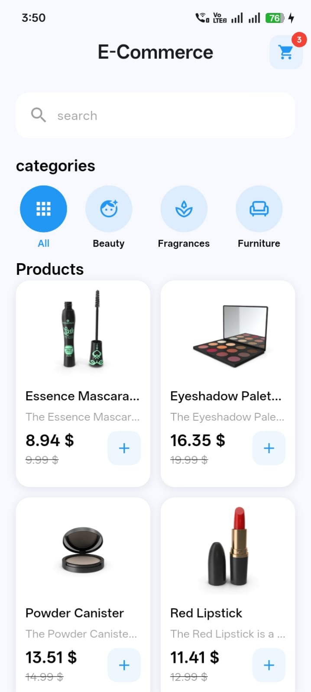
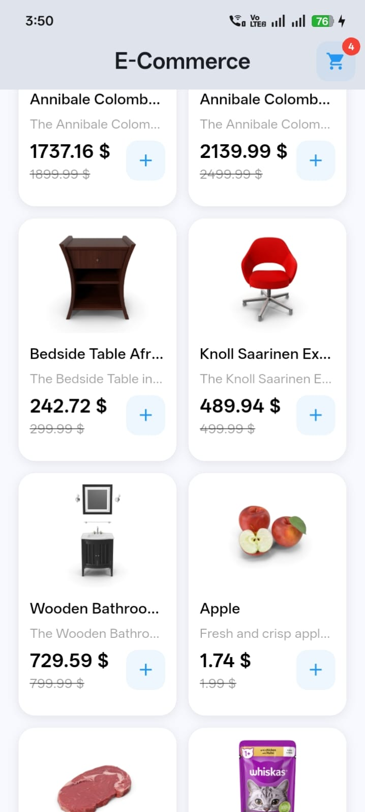
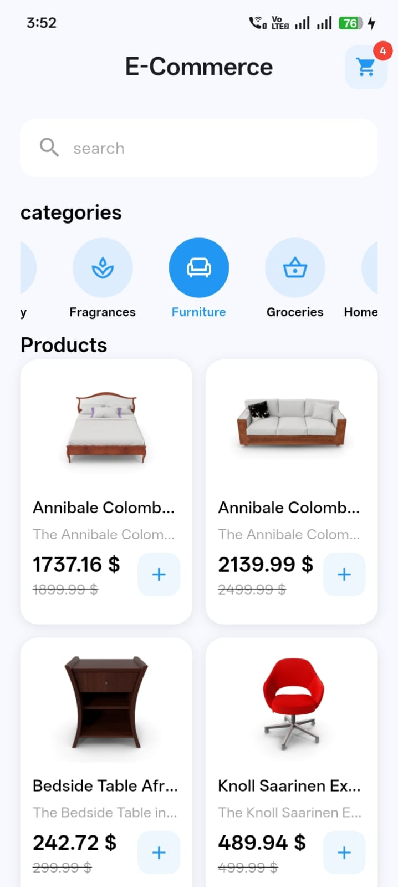
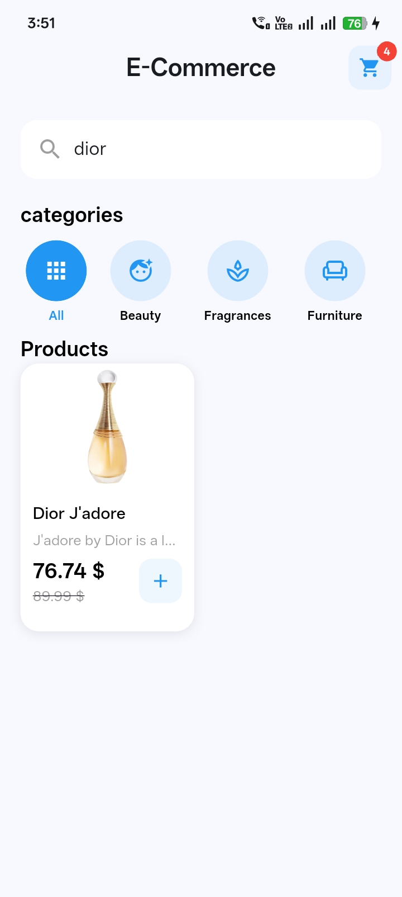
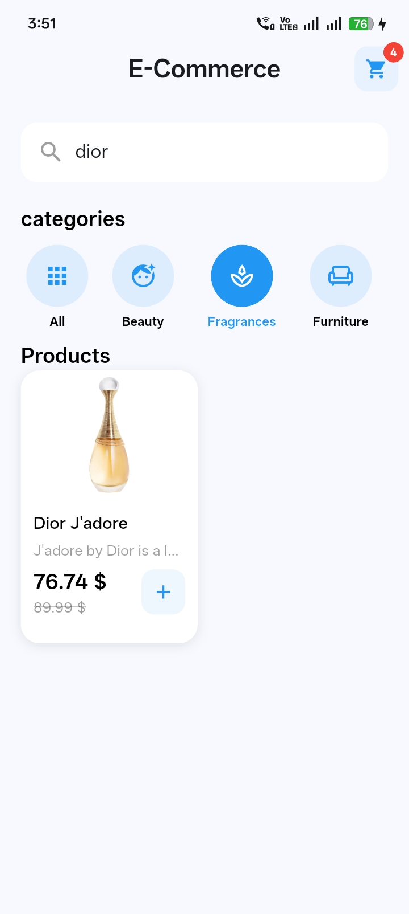
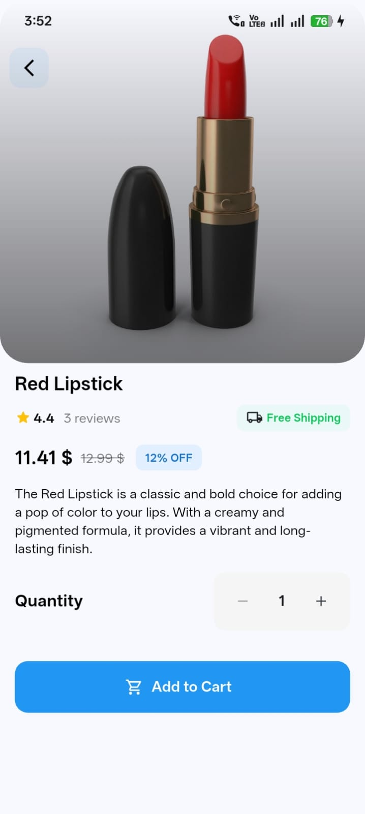
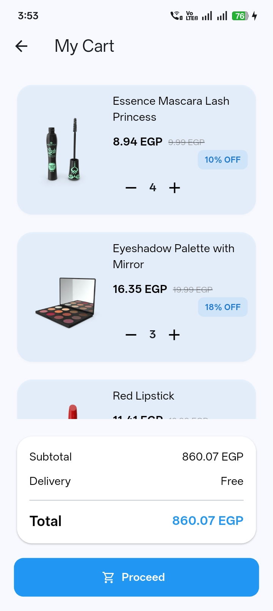
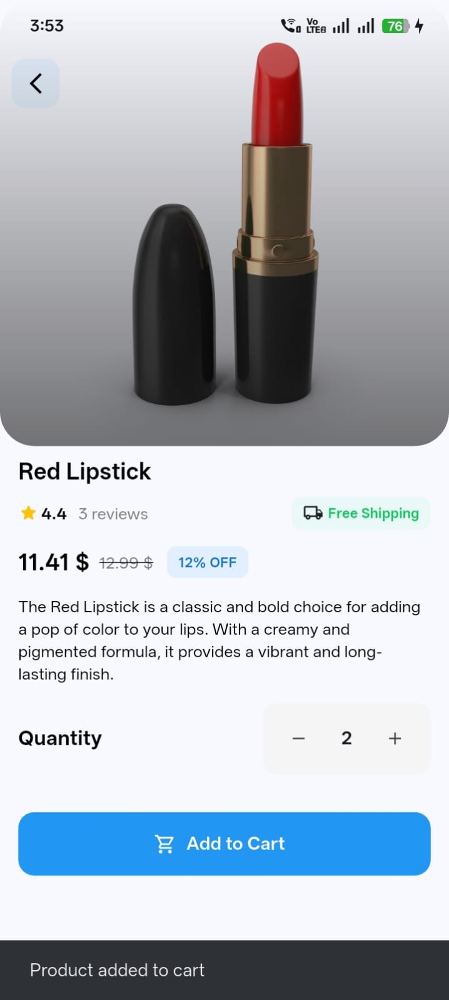
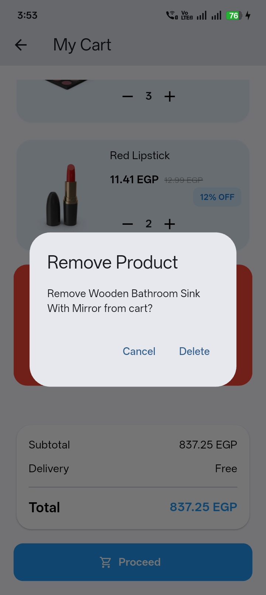
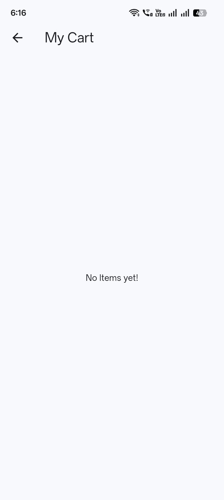

# E-Commerce App 🛍️

A Flutter E-Commerce application built with **Clean Architecture**, **Cubit**, and **Hive**. The app allows users to browse products, explore categories, search and filter products, view product details, and manage a shopping cart with locally persisted data.

## ✨ Features

- **Product Browsing:** Browse products fetched from the DummyJSON API.
- **Product Categories:** Explore products by category.
- **Search:** Search for products by name.
- **Category Filtering:** Combine search with category selection.
- **Product Details:** View product descriptions, prices, ratings, stock availability, and images.
- **Shopping Cart:** Add products to the cart and manage quantities.
- **Local Persistence:** Cart data is stored locally using Hive and remains available after restarting the app.
- **Discount Calculation:** Display discounted product prices.
- **Cart Management:** Update quantities and remove products from the cart.
- **Cart Summary:** View the order summary and delivery information.

## 🛠️ Technologies & Packages

- **Flutter & Dart** – UI development.
- **flutter_bloc** – State management using Cubit.
- **Dio** – REST API integration.
- **Hive** – Local data persistence.
- **GetIt** – Dependency injection.
- **Equatable** – Value equality.
- **Flutter ScreenUtil** – Responsive UI design.
- **DummyJSON API** – Product and category data.

## 🏗️ Architecture

The project follows **Clean Architecture**, separating the application into three main layers:

- **Data Layer:** Remote data sources, local data sources, models, and repository implementations.
- **Domain Layer:** Entities, repository contracts, and use cases.
- **Presentation Layer:** Screens, widgets, Cubits, and states.

This structure improves code organization, maintainability, and scalability.

## 📸 Screenshots

### Home & Products

| Home Screen | Product List |
|---|---|
|  |  |

### Categories & Search

| Product Categories | Search – All Categories |
|---|---|
|  |  |

| Search – Filtered Category |
|---|
|  |

### Product Details & Cart

| Product Details | Cart Screen |
|---|---|
|  |  |

| Cart Quantity | Cart Delete |
|---|---|
|  |  |

| Empty Cart |
|---|
|  |

## 🚀 Getting Started

### Prerequisites

- Flutter SDK
- Dart SDK
- Android Studio or Visual Studio Code

### Installation

1. Clone the repository:

   ```bash
   git clone https://github.com/mohamed3hussin/e_commerce_app.git
   ```

2. Navigate to the project directory:

   ```bash
   cd e_commerce_app
   ```

3. Get the dependencies:

   ```bash
   flutter pub get
   ```

4. Run the application:

   ```bash
   flutter run
   ```

## 🌐 API

This project uses the [DummyJSON API](https://dummyjson.com/products) to retrieve product information and categories.

## 📝 Notes

- Shopping cart data is stored locally using Hive.
- Product data is retrieved from the DummyJSON API.
- The checkout button is currently a UI demonstration; no real payment or order processing is integrated.

## 👨‍💻 Developer

**Mohamed Ahmed Hussin**

- GitHub: [mohamed3hussin](https://github.com/mohamed3hussin)
- LinkedIn: [Mohamed Hussin](https://www.linkedin.com/in/mohamed-hussin-404969341/)